# WorldPainter MacroMachine Plugin

Four tools that make WorldPainter faster and easier:

<table>
<tr>
<td width="50%" valign="top">

**[3D export preview](#3d-preview)**<br>
See exactly what you will export and how it will look in Minecraft, before you export.

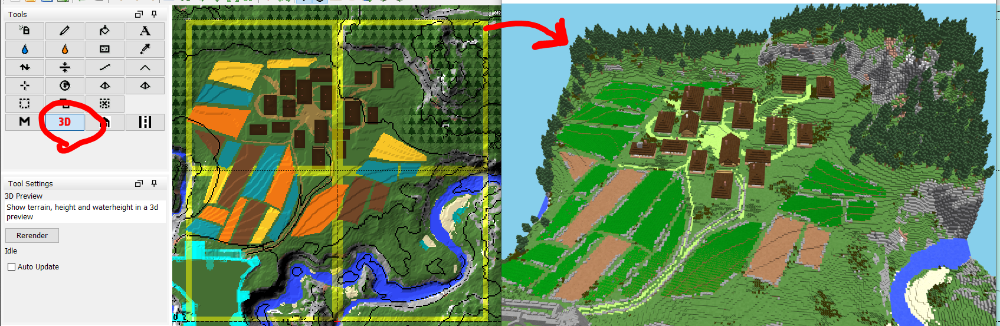
</td>
<td width="50%" valign="top">

**[Path tool](#path-tool)**<br>
Click to place roads and rivers. They blend smoothly into the terrain.

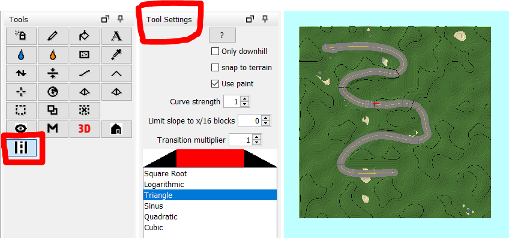
</td>
</tr>
<tr>
<td width="50%" valign="top">

**[Macros](#use-macros)**<br>
Paint your whole map with one click: snowy peaks, beaches, alpine mountains, mesas, swamps and more.


</td>
<td width="50%" valign="top">

**[CityLayer](#citylayer)**<br>
Place buildings (schematics) exactly where you want them, then move, rotate and copy them.

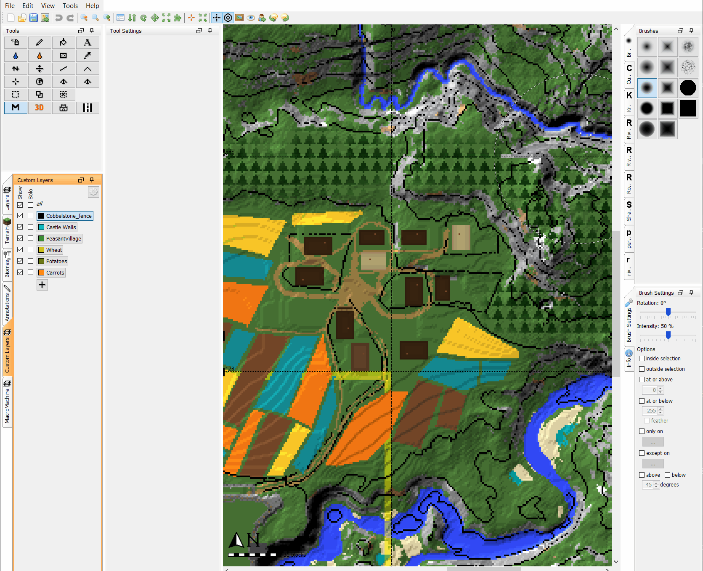
</td>
</tr>
</table>

## Install (Windows)

<a href="https://github.com/IR0NSIGHT/MacroMachine-WpPlugin/releases/download/release-0.4.21/MacroMachine-Setup-0.4.21.exe"></a>

1. Click the green **DOWNLOAD** button.
2. Close WorldPainter.
3. Open the downloaded file. If Windows says **"Windows protected your PC"**, click **More info**, then **Run anyway**.
4. Click **Install**. If Windows asks whether to allow changes, click **Yes**.
5. Click **Finish**. WorldPainter opens with MacroMachine.

## Try a macro (1 minute)

<a href="https://github.com/IR0NSIGHT/MacroMachine-WpPlugin/releases/download/release-0.4.21/default-macros.zip"></a>

1. Click the green **DOWNLOAD** button above and unzip the file (right-click → **Extract All**).
2. In WorldPainter, click the **M** tool. The MacroMachine window opens.  
   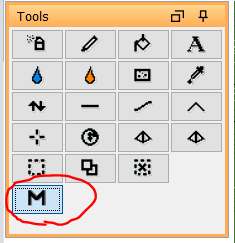
3. Click **Import** at the bottom, open the unzipped `defaultActions` folder, select all files (**Ctrl + A**) and click **Open**.
4. Click a macro in the list. Its description at the top right tells you what it does.
5. Click **▶** (Start macro) at the bottom. The macro runs on your whole map.

New to MacroMachine? Watch the 100-second overview:

[](https://youtu.be/Q5R2G-uRatc?si=GLZmCLouRVHKsX-7)

More videos: [tutorial playlist](https://youtube.com/playlist?list=PLyNqTiCLQP-gTNoBJlvTK3xeIs6RQjUkl&si=5lPTMk5lmbzcvMZM).

## More about installing

**Update:** do the install steps again.  
**Uninstall:** Windows Settings → Apps → **MacroMachine for WorldPainter** → Uninstall. Your macros stay.

<details>
<summary><b>Problems?</b></summary>

- **"WorldPainter is running"**: save your worlds, close WorldPainter, click **Retry**.
- **"WorldPainter was not found"**: click **Browse** and pick the folder that contains `worldpainter.exe`.
- **"MacroMachine needs Java 21 or newer"**: install a newer Java, for example from [adoptium.net](https://adoptium.net), then run setup again. If WorldPainter still uses the old Java, reinstall WorldPainter.
- **"Administrator permission was not given"**: run setup again and click **Yes** when Windows asks.

</details>

<details>
<summary><b>Mac, Linux, or installing by hand</b></summary>

[YouTube tutorial](https://youtu.be/FtfwxDTzWgk?si=2JaUsOgvU1c2SFsF)

1. Open the [latest release](https://github.com/IR0NSIGHT/MacroMachine-WpPlugin/releases/latest) and download `Macro-Machine-Plugin-X.Y.Z.jar`.
2. If you had MacroMachine 0.4.14 or older: open WorldPainter, go to **Tools → Open plugins folder**, and delete the old MacroMachine `.jar` file.
3. Install the downloaded `.jar` with the [WorldPainter plugin installer](https://www.patreon.com/wpdude/posts/worldpainter-v0-164248344).
4. Restart WorldPainter.

</details>

<details>
<summary><b>Very old versions (before 0.4.14)</b></summary>

1. On the [releases page](https://github.com/IR0NSIGHT/MacroMachine-WpPlugin/releases), download `Macro-Machine-Plugin-X.Y.Z.jar` of the version you want.
2. Open WorldPainter and go to **Tools → Open plugins folder**.
3. Put the downloaded `.jar` file into that folder.
4. Restart WorldPainter.

</details>

<details>
<summary><b>For developers</b></summary>

How the installer is built and tested: [installer/windows/README.md](installer/windows/README.md).

</details>

## Using MacroMachine

### Use Macros
[Youtube Tutorial](https://youtu.be/to27vExZfoM?si=CPMGnqGgRdljYbB3)  
1. Find the Macro tool and left click it. The macro panel will open.  

2. Select the macro you want to execute by left clicking it in the tree view.  
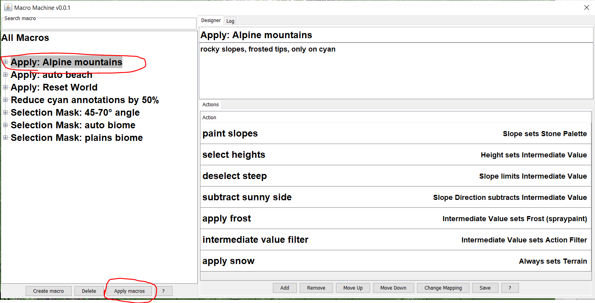
3. Click **▶** (Start macro) at the bottom. The macro runs on the whole map.

4. Click into worldpainter or close the Macro Panel. 
5. Deselect macro tool, reselect macro tool to open the panel again.

### CityLayer
CityLayer works like a Custom Object Layer, but places individual schematics at precise positions instead of painting random placements.

CityLayer uses each schematic's offset. Center the offset in the options for each schematic for predictable placement.

> Tip: press the `?` button in the City Tool options for the live help dialog. The full control list is defined in `OptionsPanel.HELP_ITEMS` / `HelpCatalog.CITY` and rendered to `target/help-screenshots/city-tool.png` during `mvn verify`.

<table>
<tr>
<td width="50%" valign="top">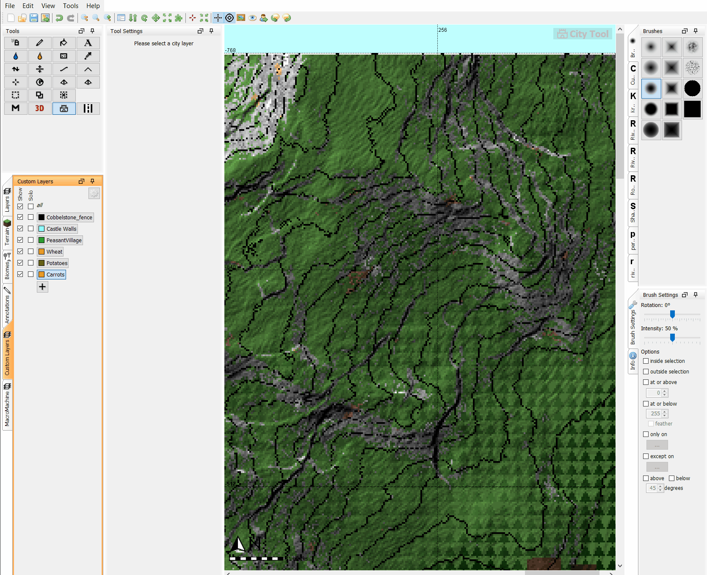</td>
<td width="50%" valign="top">

**Setup — Create & Select**
- Create a new custom layer named `CityLayer` and add schematics.
- Select the `CityLayer` and the House-icon City Tool, then select a schematic in the tool options.
- Place with `Ctrl` + left click. Using the 3D Preview with Auto Update is recommended.

</td>
</tr>
</table>

#### Selection

<table>
<tr>
<td width="50%" valign="top">
<br>
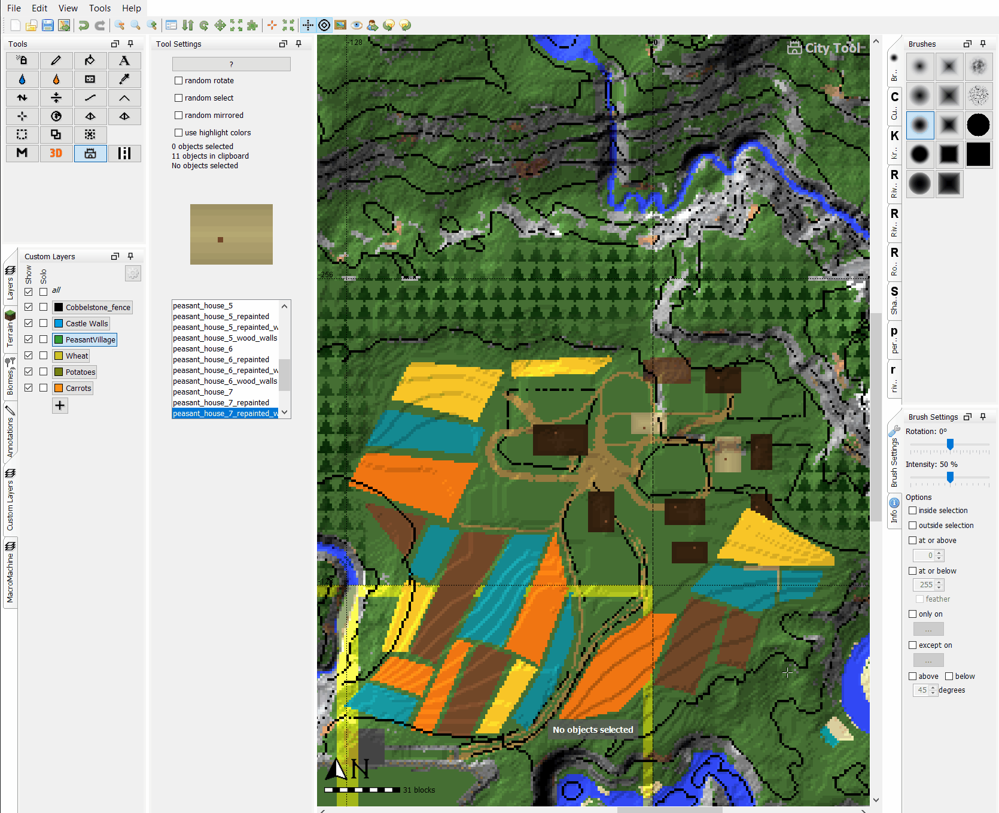
</td>
<td width="50%" valign="top">

- `Ctrl` + left click: place a new building.
- `Left click`: select or deselect the building under the cursor. Clicking an already selected building toggles it off; clicking empty space clears the selection.
- `Left-button drag`: select buildings fully inside the drag rectangle. Outlines are shown while dragging.
- `Ctrl + A`: select all buildings in the layer.
- `Escape`: clear the selection.
- `Shift` + mouse wheel: change the selected building type for the whole selection (or the brush when nothing is selected).
- Selection count and status messages are shown in the tool options and as a transient overlay on the map.

</td>
</tr>
</table>

#### Transforming the selection

<table>
<tr>
<td width="50%" valign="top">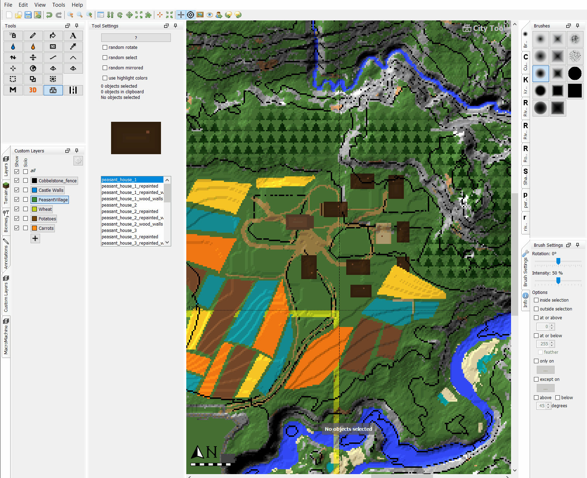</td>
<td width="50%" valign="top">

- `Right click`: move the selection center to the cursor position.
- `W`/`A`/`S`/`D`: move selected buildings by one block.
- `C`: rotate selected buildings around the selection center.
- `X`: mirror selected buildings.
- `Q`: randomize selected buildings using the enabled random options.
- `Delete`: delete selected buildings.

</td>
</tr>
</table>

#### Clipboard

<table>
<tr>
<td width="50%" valign="top">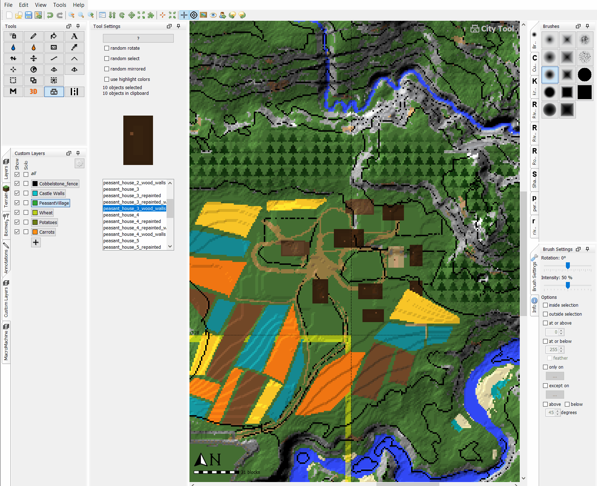</td>
<td width="50%" valign="top">

- `Ctrl + C`: copy selected buildings to the clipboard (offsets relative to the active building are preserved).
- `Ctrl + X`: cut selected buildings to the clipboard.
- `Ctrl + V`: paste the clipboard at the cursor position. Paste requires the cursor over the map and the same `CityLayer`; otherwise `Clipboard is empty` or `Move the cursor over the map to paste` is shown.
- Clipboard count is shown in the tool options.

</td>
</tr>
</table>

#### Tool options

<table>
<tr>
<td width="50%" valign="top">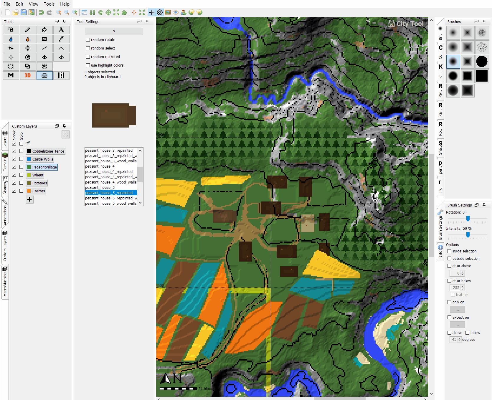</td>
<td width="50%" valign="top">

- `random rotate`: randomly rotate after each placement or when pressing `Q` on a selection.
- `random select`: randomly select a new schematic after each placement or when pressing `Q`.
- `random mirrored`: randomly mirror after each placement or when pressing `Q`.
- `use highlight colors`: show the layer color instead of the schematic.

</td>
</tr>
</table>

CityLayer is not compatible with WorldPainter undo/redo. Do not use undo/redo while editing it.

### 3D Preview
1. Open MacroMachine with the `M` tool.
2. Select the `3D Preview` tool.
3. Select an area on the map.
4. View the result in the 3D renderer.


Enable `Auto Update` to refresh the preview after map edits. Large areas can cause lag with Auto Update enabled. The preview performs a background test export and uses a workaround to remove the underground from the rendered result.

### Path Tool
Build roads and rivers along a path you shape on the map. The path blends into the terrain around it, carves a river bed, sets water and paints the path with any terrain or layer.

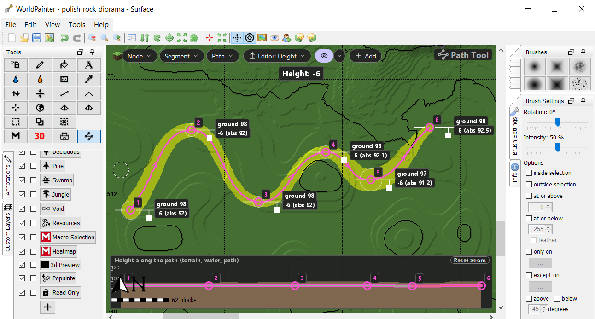

#### Placing and selecting nodes
- Select the Path Tool (path icon). A new path starts with six nodes across the middle of the view, so there is always something to grab. Path > New path starts over the same way.
- `Ctrl` + left click on the map adds a node after the last selected node (or at the end). The **Add** button, or tapping `Ctrl` twice, switches to adding nodes with plain clicks.
- Left click or drag selects nodes (box selection); drag selected nodes to move them. `Shift` while dragging moves at 1/10 speed for precise placement.
- `Delete` removes the selected nodes, `Ctrl+A` selects all, `Escape` clears the selection. Undo and redo work as everywhere in WorldPainter.
- New nodes have a radius of 8 blocks.

#### Node operations
The **Node**, **Segment** and **Path** menus (top left) hold the operations. Each one previews on the map before you apply it (`Enter`) or cancel it (`Esc`); type a number to set its main value.

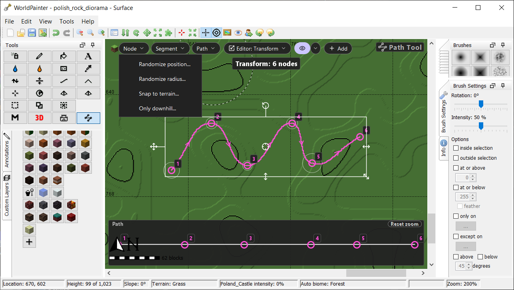

- Node: randomize position, randomize radius, snap to terrain, only downhill.
- Segment: subdivide.
- Path: new path, reverse direction (e.g. so a river flows the other way), apply as road / river / paint, help.

#### Editors
The editor button (top left) picks what the handles on the selected nodes edit: **Radius**, **Curve strength**, **Height** or **Transform** (move, rotate and scale several nodes). Clicking a selected node cycles through them. Curve strength only bends the path sideways; the height between nodes always runs smoothly from one node's height to the next, without overshooting.

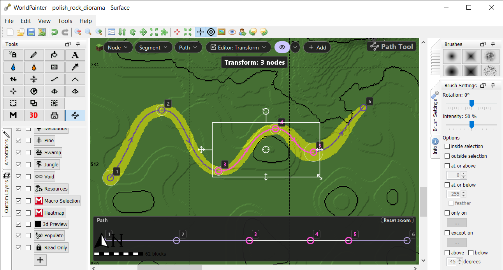

The strip at the bottom unrolls the path: in the Height editor it shows the terrain, the water and the path's height block by block, red where it rises and green where it falls.

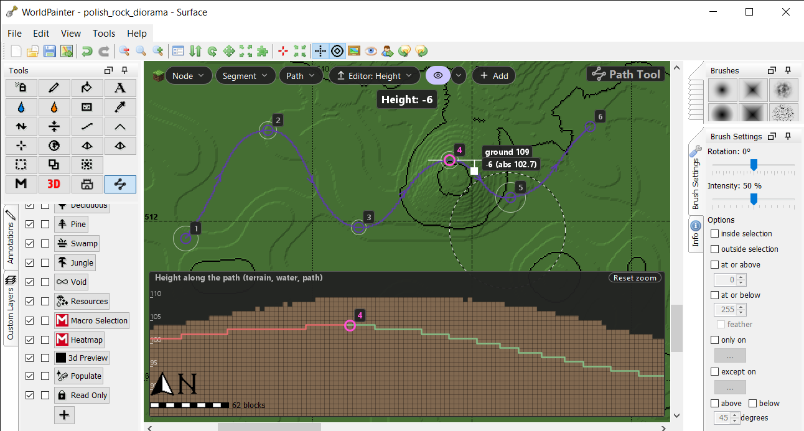

#### Apply as river / road / paint
Path > Apply as river, Apply as road or Apply as paint opens its settings. The map preview follows the settings; **Apply** builds the path into the world (undo takes it back). Each dialog remembers its settings, **Reset** brings back its defaults, **Close** just closes it.

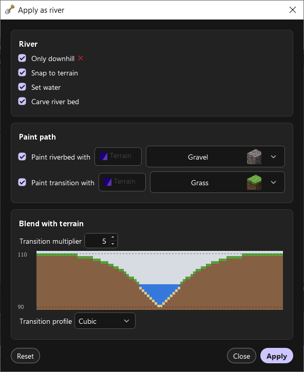 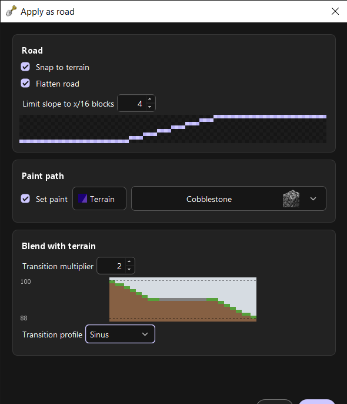

River:
- **Only downhill**: the river never rises along its direction. The check or cross behind it tells whether the nodes already run downhill.
- **Snap to terrain**: every position follows the terrain height. Snap runs first, then only downhill, so either works on its own.
- **Set water**: sets the water level to the path height inside the path radius.
- **Carve river bed**: digs a bed below the water, one block deep at the banks and deeper towards the middle.
- **Paint riverbed with / Paint transition with**: any terrain or layer and its value, for the bed and for the banks.

Road:
- **Snap to terrain**, **Flatten road** (the ground under the road is set to its height) and **Set paint** with any terrain or layer.
- **Limit slope to x/16 blocks**: at most x blocks up or down per 16 blocks along the road (16/16 is a staircase, 8/16 slabs, 4/16 a gentle road). 0 = no limit.

Paint: only paints the path with the chosen terrain or layer; heights and water stay as they are.

Blend with terrain (river and road): **Transition multiplier** sets how far beyond the path the terrain blends into it, in path radii; **Transition profile** sets the shape of that blend. The cross section below them shows the result to scale, one square per block.

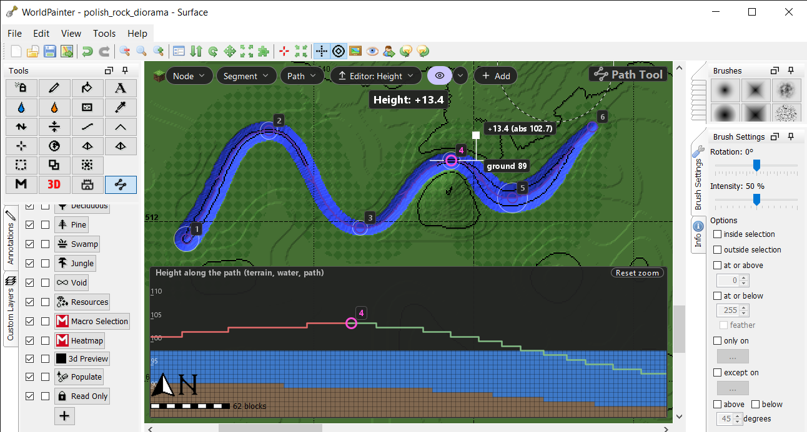

*The height strip shows the path as planned by its nodes; Snap to terrain lowered the river into the terrain on Apply.*

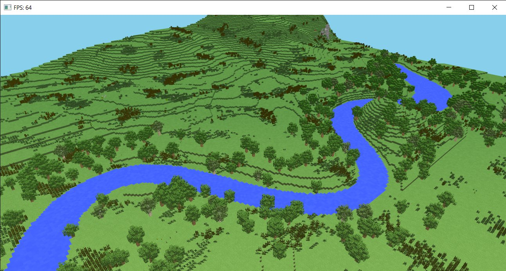

### Edit Macros
[Youtube Tutorial](https://youtu.be/jog4qHFP4WI?si=gqlX9unvOYhtRQ4x)  
Let's create a simple macro that creates a mask for us:  add all Swamp and Desert biome to selection. 
1. Create a new macro by clicking "Create Macro". A new macro with the name "New mapping macro" appears in the tree panel.
2. Left click "New Mapping Macro". It is now shown in the macro designer on the right.  
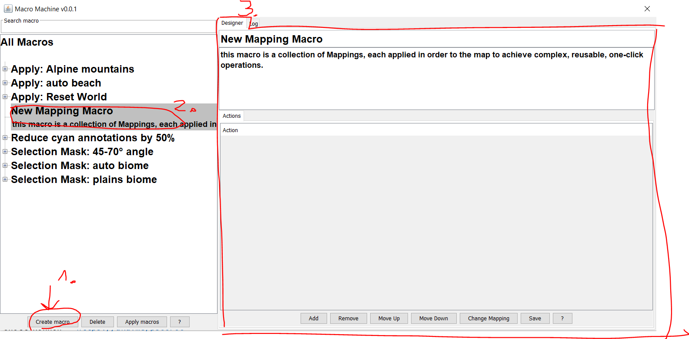
3. The macro is a list of actions that are run in fixed order. Topmost action goes first, bottom most action goes last. Right now the list is still empty.
4. Click "Add", then select "create new action" in the dialog. A new action is created and added to the list. Press "save" to save the changes we made to this macro.
5. In the tree view (left), expand the Macro. You can see that is now has an action listed. Select the action  
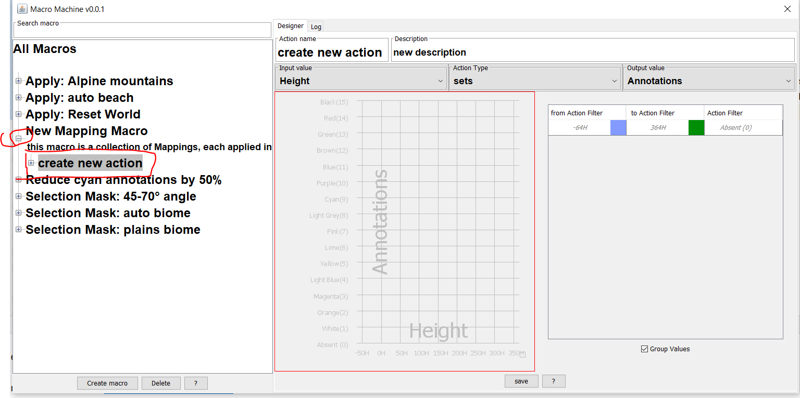
6. The Action Designer now opens on the right. Select "biome" as input, "set" as type, "selection block" as output.
7. In the table on the right, set "swamp" and "desert" to "Selection Block: ON". This means when the action is executed, all blocks that are "swamp" or "desert" biome are set to be selected. All blocks that are a different biome are deselected.  
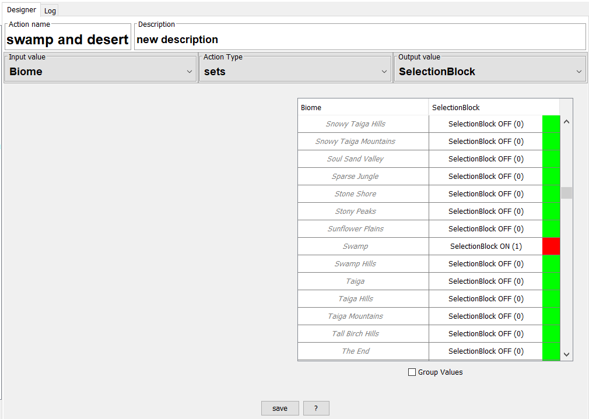
8. Save your progressof this action with the "save" key
9. Select the macro where the action lives in.
10. Press "execute macro"
11. All swamp and desert biome blocks are now selected, everything else is deselected  
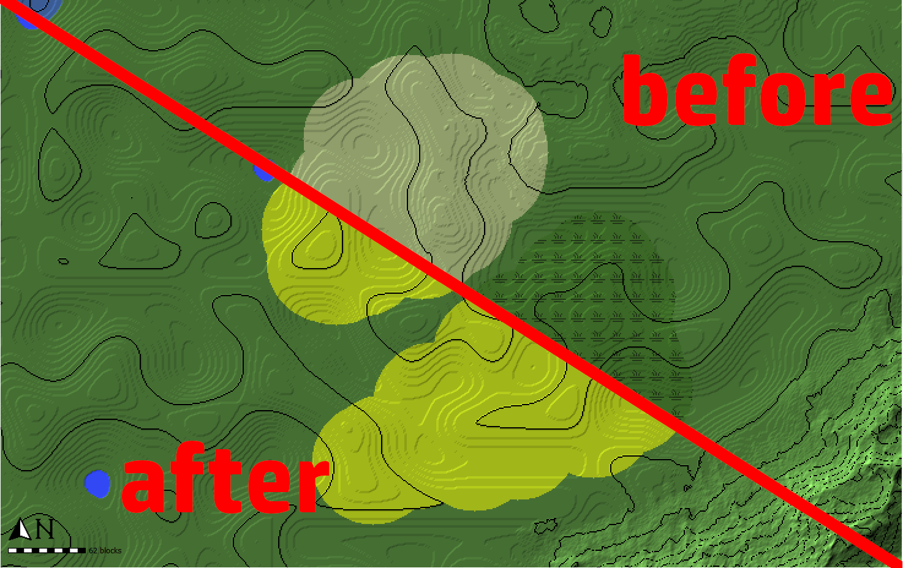
12. check the "log" tab, to see some statistics about your action.  
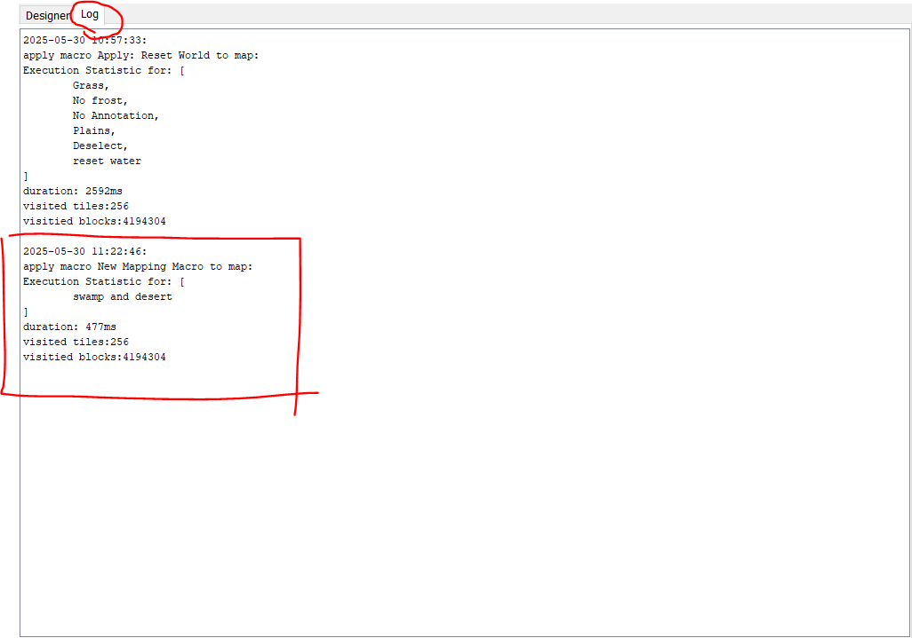

### Gradient Editor
Not all actions are simple "if this, then this", like our desert-and-swamp-to-selection example.
If you want to paint pine trees in flat slopes and reduce the amount the steeper it gets, a 1:1 mapping for each angle is very tedious.
For this, the gradient editor exists.
1. Create an action with input: slope, type: set, output: pines
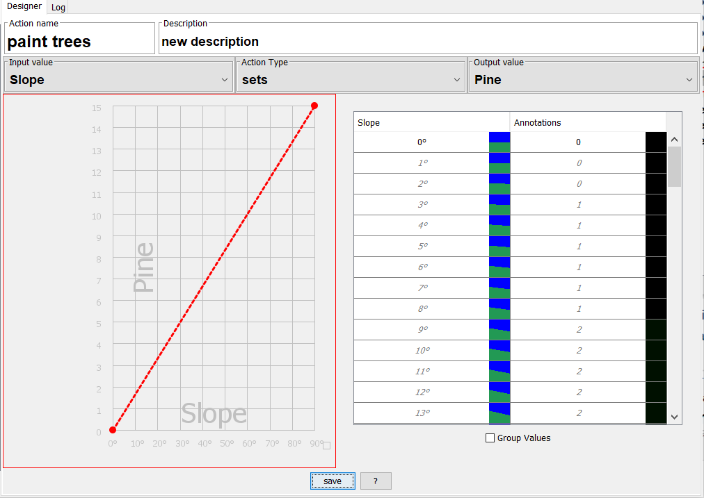
2. The x axis (bottom) is the input values
3. The y axis (left) is the output value
4. The curve shows you which input is mapped to which output value
5. Left click into the curve to add a new point
6. Drag points to change where you want them
7. Right click to delete a point
8. Values between points are automatically interpolated
9. the curve below means that pines are set with strength=10 when the slope is 0°. the steeper the area, the lower pine strength gets, up until 60° slope with strength=7. Then it falls to strength=0 at slope=70°.
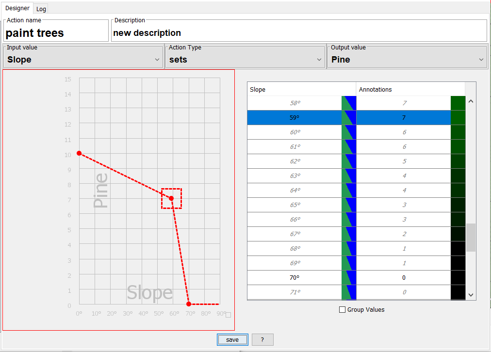
10. You can edit values in the table, but only where points are set. Editable values are black, Interpolated values are grey.
11. Run the action on a world with a mountain
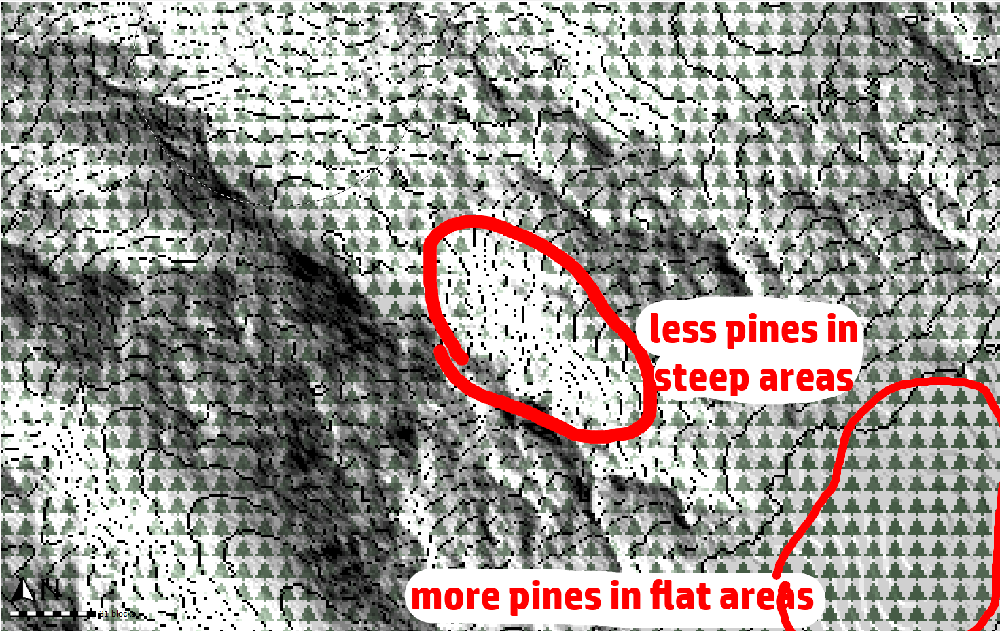
12. Sometimes the input can be interpolated, but the output is fixed values, like mapping slope to annotation colors. If that happens, the gradient editor is available and you can define input ranges to map to specific values:
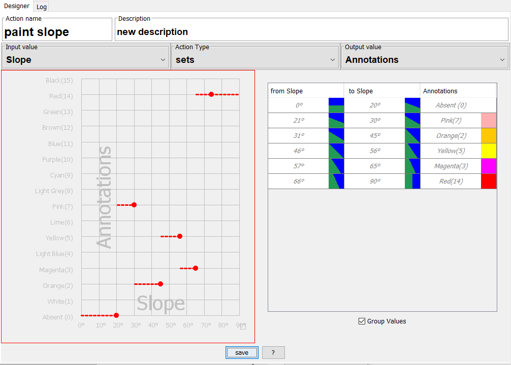
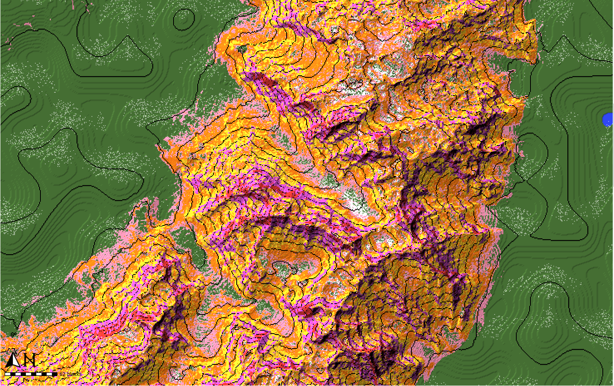

### Filter
If you only want to operate on some parts of the map, you should use the action filter. Create an action that uses an input to set the action filter.
Any actions in the macro after the filter action will ignore blocks that were previously filtered out.

Use this pattern for filters:
```
    Input: what you want to filter (f.e. Annotations)
    Type: set
    Output: Action Filter
```
then set all values you DONT want to "block" and everything else to "ignore". This will filter out all these values for any subsequent actions.

More restrictive filters usually also mean better performance, because less tiles have to be touched by the macro.

### Always input
Use the "Always" input to apply an output everywhere. Always still respects previous Action-Filters and will ignore filtered out blocks.

### Spraypaint
Spraypaint output will spraypaint a layer onto blocks with certain chance for each block.

### Intermediate value
obsolete and discontinued. please dont use it anymore.

### Nesting macros
You can call a macro inside of another macro. It will inherit the filter state and can edit it.

### Custom layers
MacroMachine offers you all customer layers in your current .world project AND all custom layers that are already used in Macros as inputs or outputs. If your custom layer is not shown, close the MacroMachine window, save your world and open the MacroMachine window again.

## troubleshooting
Q: What does this panel do  
A: Look for the "?" button and hover over buttons to see tooltips.

Q: If i click "Apply macros", nothing on my map happens  
A: check the log. usually, the macro does something under special circumstances that dont exist on your map, f.e. because the map is flat and the macro tries to paint mountains in steep areas. Use the debugger to step through each action, make sure annotations are visible.

Q: I updated to the newest macromachine, now worldpainter doesnt open, it just seems to do nothing (or it flashes a window for a second)?  
A: Check your worldpainter plugins directory (f.e. C:\Users\IR0NSIGHT\AppData\Roaming\WorldPainter\plugins). If you have 2 macromachine jar files, delete all except the version you want to use. This happens if you mix pre-0.4.14 and post-0.4.17 jar files. The Windows setup does this for you.

Q: Something broke, what now?  
A: Send a bug report to @IR0NSIGHT in the discord https://discord.gg/9kRJEMfGeE or on github here. You can find your log files in the parent folder of top bar -> tools -> open plugins folder. The logs are calles logfile0.txt usually, please include the latest log file.
