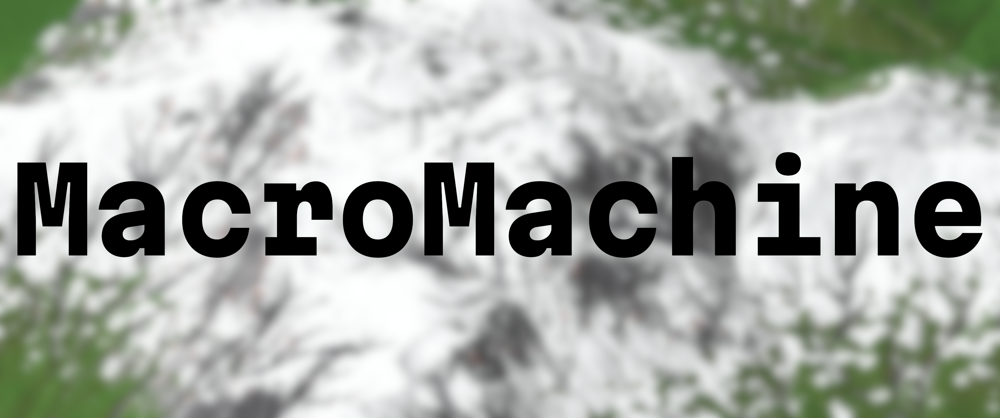

<a href="https://ir0nsight.github.io/MacroMachine-WpPlugin/"></a>

**Using MacroMachine? Go to the website: [ir0nsight.github.io/MacroMachine-WpPlugin](https://ir0nsight.github.io/MacroMachine-WpPlugin/).** It has installation, guides for every tool, and help.



# WorldPainter MacroMachine Plugin

A WorldPainter plugin: reusable macros of global operations, CityLayer for placing schematics, the Path Tool for roads and rivers, and a live 3D export preview.

<a href="https://github.com/IR0NSIGHT/MacroMachine-WpPlugin/releases/download/release-0.4.21/MacroMachine-Setup-0.4.21.exe"></a>
<a href="https://github.com/IR0NSIGHT/MacroMachine-WpPlugin/releases/download/release-0.4.21/default-macros.zip"></a>

Help and bug reports: [Discord](https://discord.gg/9kRJEMfGeE) or [GitHub Issues](https://github.com/IR0NSIGHT/MacroMachine-WpPlugin/issues).

---

> **The rest of this README is for developers.** Everything about using the plugin is on the [website](https://ir0nsight.github.io/MacroMachine-WpPlugin/).

## Repository layout

| Folder | Contents |
|---|---|
| `src/` | The plugin (Java 21, Maven). |
| `webUI/` | The plugin's React + TypeScript frontend; Maven builds and tests it (see [agents.md](agents.md)). |
| `website/` | The public website and user documentation (static Node build). See [website/README.md](website/README.md). |
| `imgs/` | Screenshots and showcase animations, used by the website and this README. |
| `defaultActions/` | The ready-made macros shipped as `default-macros.zip`. |
| `installer/windows/` | The Windows setup. See [installer/windows/README.md](installer/windows/README.md). |

## Build and test

Requires JDK 21 and Maven. From the repository root:

```sh
mvn verify                          # plugin, webUI, unit tests, formatter check (spotless)
mvn spotless:apply                  # apply the project formatter
mvn -PtestWithWorldPainter test     # start WorldPainter with the plugin
mvn -Pnative-preview-tests verify   # also run the native 3D preview integration tests
```

`mvn verify` opens and closes Swing windows during the tests. The `testWithWorldPainter` run uses its own WorldPainter configuration folder (`-Dorg.pepsoft.worldpainter.classifier=dev`), so it does not touch your normal WorldPainter settings.

## Website

The website is built from `website/` and the images in `imgs/`. A push to `master` that touches `website/**`, `imgs/**` or `pom.xml` deploys it to GitHub Pages. Before pushing, run from `website/`:

```sh
npm run verify          # build and unit tests
npm run test:browser    # Playwright browser tests
```

Showcase animations are published as animated WebP, 1360 px wide; see [website/CONTENT-NOTES.md](website/CONTENT-NOTES.md).

## Releases

1. Bump the version in `pom.xml` and, in the same commit, both DOWNLOAD links above (CI checks they match).
2. Merge into `master`. The `merge-release` workflow creates the `release-X.Y.Z` tag and updates the `release` branch.

Details: [agents.md](agents.md).

## Contributing

Pull requests are squash-merged into `master`. Rebase your branch onto the current `master` first.
